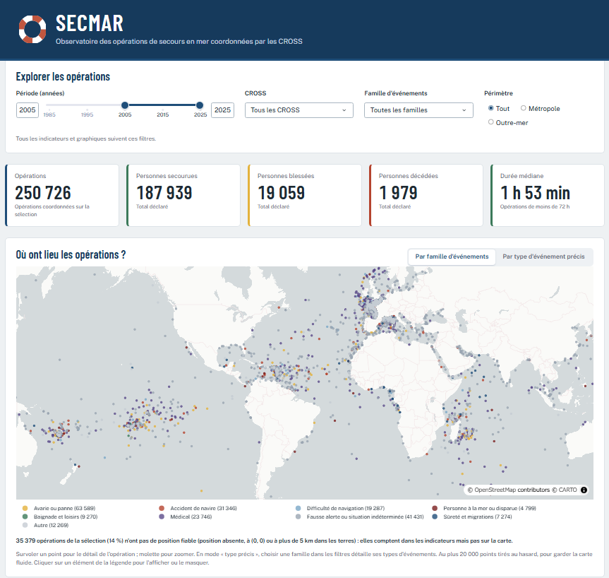

# SECMAR — Tableau de bord des opérations de secours en mer

Tableau de bord interactif (Python, Dash, Plotly, pandas, SQLite) consacré aux
opérations de recherche et de sauvetage coordonnées par les CROSS (Centres
régionaux opérationnels de surveillance et de sauvetage), de 1985 à 2025.

Il répond à six questions (quand, dans quelles conditions, avec quelles
conséquences, combien de temps et à quelle distance, où, et comment l'activité
évolue) et, pour chacune, calcule trois messages à retenir qui suivent les
filtres choisis.



---

## User Guide

### Prérequis

- [uv](https://docs.astral.sh/uv/) installé (il installe lui-même Python 3.14 si besoin).
- Environ 500 Mo d'espace disque libre.

### Installation et lancement

```bash
git clone https://git.esiee.fr/vignotv/secmar.git
cd secmar
uv sync
uv run python main.py
```

Ouvrir ensuite <http://127.0.0.1:8050> dans un navigateur.

Au premier lancement, `main.py` décompresse l'archive versionnée
`data/db_initial.sqlite.xz` en `data/db.sqlite` (quelques secondes, **sans
connexion internet**). Si l'archive est absente, les données sont téléchargées
depuis data.gouv.fr puis nettoyées (quelques minutes, connexion requise).

### Mettre à jour les données

```bash
uv run python -m src.utils.get_data      # télécharge les CSV absents de data/raw/
uv run python -m src.utils.clean_data    # reconstruit les tables raw et cleaned + l'archive
uv run python -m src.utils.inspect_data  # rapport d'inspection des CSV (lecture seule)
```

Pour forcer un nouveau téléchargement, supprimer d'abord les CSV de `data/raw/`.

### Utilisation

- **Filtres** (en haut) : période, CROSS, famille d'événements et périmètre
  (tout, métropole, outre-mer). Ils s'appliquent à toute la page.
- **Indicateurs clés** : opérations, personnes secourues, blessées, décédées,
  durée médiane d'une opération.
- **Carte** : chaque point est une opération ; cliquer sur une famille dans la
  légende pour l'afficher ou la masquer.
- **Six onglets d'analyse** : Quand ?, Conditions, Conséquences, Durée et
  distance, Où ?, Évolution. Chaque onglet commence par trois messages à
  retenir, recalculés avec les filtres. Survoler un graphique affiche le
  détail et les effectifs.
- **Bulles animées** (onglet Évolution) : appuyer sur ▶ ou faire glisser le
  curseur des années ; chaque bulle est une famille d'événements.

### Vidéo de démonstration

Lien : _à compléter après mise en ligne de la vidéo (3 minutes maximum)._
