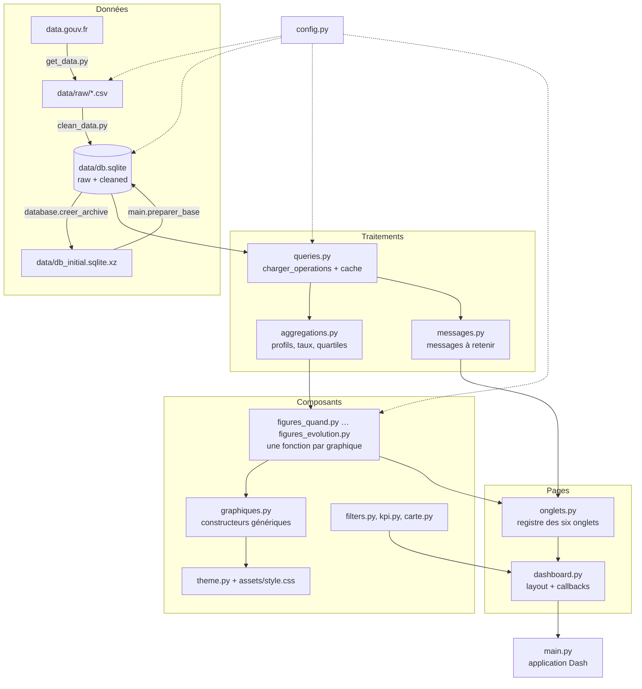

# SECMAR — Tableau de bord des opérations de secours en mer

Tableau de bord interactif (Python, Dash, Plotly, pandas, SQLite) consacré aux
opérations de recherche et de sauvetage coordonnées par les CROSS (Centres
régionaux opérationnels de surveillance et de sauvetage), de 1985 à 2025.

Il répond à six questions (quand, dans quelles conditions, avec quelles
conséquences, combien de temps et à quelle distance, où, et comment l'activité
évolue) et, pour chacune, calcule trois messages à retenir qui suivent les
filtres choisis.


**Version en ligne :** <https://secmar-224940021910.europe-west1.run.app> (aucune installation nécessaire ; le premier chargement peut prendre quelques secondes).

---

## User Guide

Comment installer, lancer et utiliser le tableau de bord, sans connaissance du code.

### Prérequis

- [uv](https://docs.astral.sh/uv/) installé (il installe lui-même Python 3.14 si besoin).
- Environ 500 Mo d'espace disque libre.

### Installation et lancement

```bash
git clone https://git.esiee.fr/vignotv/dataproject.git
cd dataproject
uv sync
uv run python main.py
```

Ouvrir ensuite <http://127.0.0.1:8050> dans un navigateur.

Au premier lancement, `main.py` décompresse l'archive versionnée
`data/db_initial.sqlite.xz` en `data/db.sqlite` (quelques secondes, **sans
connexion internet**). Si l'archive est absente, les données sont téléchargées
depuis data.gouv.fr puis nettoyées (quelques minutes, connexion requise).

### Mettre à jour les données

```bash
uv run python -m src.utils.get_data      # télécharge les CSV absents de data/raw/
uv run python -m src.utils.clean_data    # reconstruit les tables raw et cleaned + l'archive
uv run python -m src.utils.inspect_data  # rapport d'inspection des CSV (lecture seule)
```

Pour forcer un nouveau téléchargement, supprimer d'abord les CSV de `data/raw/`.

### Utilisation

- **Filtres** (en haut) : période, mois de l'année (par exemple juin à août
  pour l'été), CROSS, famille d'événements et périmètre (tout, métropole,
  outre-mer). Ils s'appliquent à toute la page.
- **Indicateurs clés** : opérations, personnes secourues, blessées, décédées ou
  disparues, durée médiane d'une opération.
- **Carte** : chaque point est une opération ; la survoler affiche son détail
  (type d'événement, CROSS, mois, personnes concernées, distance, durée). Le
  sélecteur en haut à droite colore les points par famille ou par type
  d'événement précis ; choisir une famille dans les filtres détaille alors ses
  types. La carte se cadre sur la sélection ; molette pour zoomer, clic sur la
  légende pour afficher ou masquer une catégorie.
- **Six onglets d'analyse** : Quand ?, Conditions, Conséquences, Durée et
  distance, Où ?, Évolution. Chaque onglet commence par trois messages à
  retenir, recalculés avec les filtres. Survoler un graphique affiche le
  détail et les effectifs.
- **Bulles animées** (onglet Évolution) : appuyer sur ▶ ou faire glisser le
  curseur des années ; chaque bulle est une famille d'événements.

### Vidéo de démonstration

Lien : <https://youtu.be/brjvKaakvZ4>

---

## Data

| Élément | Détail |
| --- | --- |
| Jeu de données | [Opérations coordonnées par les CROSS](https://www.data.gouv.fr/fr/datasets/operations-coordonnees-par-les-cross/) |
| Producteur | Direction générale des affaires maritimes, de la pêche et de l'aquaculture (DGAMPA) |
| Licence | Licence Ouverte / Open Licence |
| Documentation officielle | <https://mtes-mct.github.io/secmar-documentation/> |
| Fichiers utilisés | `operations.csv`, `operations_stats.csv` (et `flotteurs.csv`, `resultats_humain.csv` téléchargés pour l'inspection) |
| Trait de côte | [Natural Earth, Land 1:10m, v5.1.2](https://www.naturalearthdata.com/downloads/10m-physical-vectors/10m-land/) (domaine public), pour le contrôle des positions |
| Volume | 394 756 opérations, d'août 1984 à juillet 2026 |

Liens de téléchargement (ressources stables data.gouv.fr, utilisées par `get_data.py`) :

- operations : <https://www.data.gouv.fr/api/1/datasets/r/fae6bc13-fe4c-4838-b281-b16628b7babe>
- operations_stats : <https://www.data.gouv.fr/api/1/datasets/r/5d3c65fb-c861-4b22-b8aa-1eab58e3d9db>
- flotteurs : <https://www.data.gouv.fr/api/1/datasets/r/ae0e17e4-7117-45f0-80c4-b11b38f31c5c>
- resultats_humain : <https://www.data.gouv.fr/api/1/datasets/r/8eb7f207-1ce5-460c-b941-5f1761a79c46>
- trait de côte : <https://raw.githubusercontent.com/nvkelso/natural-earth-vector/v5.1.2/geojson/ne_10m_land.geojson>

### Stockage

La base `data/db.sqlite` contient deux tables :

- `raw` : colonnes utiles des deux CSV, jointes sur `operation_id`, valeurs inchangées ;
- `cleaned` : données typées et variables calculées.

Une copie compressée (`data/db_initial.sqlite.xz`, environ 20 Mo) est versionnée :
elle permet de lancer l'application sans connexion.

### Nettoyage et variables calculées

| Variable | Construction |
| --- | --- |
| `famille` | Regroupement des 68 types d'événements (`evenement`) en 9 familles stables (`src/utils/familles.py`) |
| `saison` | Hiver (déc.-févr.), printemps, été, automne, à partir du mois |
| `classe_vent`, `classe_mer` | Regroupement des échelles de Beaufort (0-3, 4-5, 6-7, 8+) et de Douglas (0-2, 3, 4, 5+) |
| `duree_heures` | Fin - réception de l'alerte ; durées nulles, négatives ou supérieures à 72 h écartées |
| `gravite` | Aucune victime / blessés / décès ou disparus |
| `zone` | Façade maritime (Manche - mer du Nord, Atlantique, Méditerranée) ou Outre-mer |
| `latitude`, `longitude` | Retirées (opération sans position) si la position est (0, 0) ou à terre à plus de 5 km de la côte (trait de côte Natural Earth) |
| `distance_cote_mn` | Distance fournie par la source, conservée uniquement en métropole et pour les positions valides |
| `est_evacuation` | Événements d'évacuation sanitaire ou médicale |

Corrections de libellés : CROSS « Adge » → « Agde », département « Réunion » → « La Réunion ».

### Limites connues

- **Deux ruptures de saisie**, grisées sur la courbe annuelle :
  - en 2009-2010, les « difficultés de manœuvre » sont remplacées par les
    « avaries du système de propulsion » : une partie des opérations passe de la
    famille « Difficulté de navigation » à « Avarie ou panne » ;
  - en 2019-2021, le passage du logiciel SECMARweb au logiciel SEAMIS rend la
    colonne `categorie_evenement` incomparable dans le temps (les fausses alertes
    y disparaissent), d'où l'usage des familles construites sur `evenement`.
- Vent et mer manquent pour environ 27 à 29 % des opérations, davantage dans les
  années 2000.
- La distance à la côte est aberrante en Polynésie, en Martinique et pour les
  positions (0, 0) : elle n'est utilisée qu'en métropole.
- 44 412 positions de l'ancien système sont situées à terre, à plus de 5 km de la
  côte (positions par défaut : centre d'une commune, bâtiment d'un CROSS) ; avec
  les 3 316 positions (0, 0) et les 54 941 opérations déjà sans position, elles
  portent à 102 669 (26 %) le nombre d'opérations absentes de la carte.
- Les évacuations sanitaires sont presque toutes antérieures à 2021 (ancien système).
- 3 935 opérations de 2005-2025 n'ont pas de type d'événement (« Non renseigné ») :
  elles comptent dans les indicateurs mais sont écartées des analyses et de la carte.
- Environ 4 % des opérations de métropole sont à plus de 200 milles des côtes
  (surtout des alertes relayées depuis l'étranger par Gris-Nez) : elles forment
  une classe de distance à part, pour ne pas fausser la comparaison avec le large proche.
- Les données décrivent les opérations déclenchées, pas l'exposition au risque :
  il y a davantage de monde en mer l'été et par beau temps.

---

## Developer Guide

Comment le code est organisé, quelles technologies il utilise et comment le faire évoluer (ajouter un graphique, un onglet, un message ou une colonne).

### Architecture



| Dossier / fichier | Rôle |
| --- | --- |
| `config.py` | Chemins, période, seuils, classes, libellés, ruptures de saisie : toutes les décisions modifiables |
| `main.py` | Prépare la base puis lance l'application Dash |
| `src/utils/get_data.py` | Téléchargement des CSV et du trait de côte |
| `src/utils/clean_data.py` | Construction des tables `raw` et `cleaned` |
| `src/utils/familles.py` | Correspondance événement → famille |
| `src/utils/geographie.py` | Repérage des positions situées dans les terres (shapely) |
| `src/utils/database.py` | Moteur SQLAlchemy et connexion SQLite en lecture seule, archive compressée |
| `src/utils/queries.py` | Filtres validés par pydantic, requête SQLAlchemy filtrée unique (avec cache), indicateurs clés |
| `src/utils/aggregations.py` | Calculs statistiques réutilisables |
| `src/utils/messages.py` | Messages à retenir de chaque onglet, recalculés avec les filtres |
| `src/utils/inspect_data.py` | Rapport d'inspection des CSV (`data/inspection_rapport.txt`) |
| `src/components/graphiques.py` | Constructeurs génériques (carte de chaleur, boîtes, histogramme, courbes, barres) |
| `src/components/figures_*.py` | Les graphiques de chaque onglet |
| `src/components/` (autres) | Filtres, indicateurs, carte, bandeau de messages, thème |
| `src/pages/onglets.py` | Registre des onglets : question, messages et graphiques |
| `src/pages/dashboard.py` | Mise en page et callbacks |
| `assets/style.css` | Apparence de la page (charte « Signalétique portuaire »), chargée automatiquement par Dash |
| `assets/logo.svg`, `assets/fonts/` | Pictogramme (bouée, dessin original) et polices libres embarquées |
| `tests/` | Tests unitaires (pytest), sur un échantillon synthétique de 2 000 opérations |

### Ajouter un graphique

1. Écrire une fonction `figure_xxx(donnees: pd.DataFrame) -> go.Figure` dans le
   fichier `src/components/figures_*.py` de l'onglet voulu, en s'appuyant sur
   `src/utils/aggregations.py` et sur les constructeurs de `graphiques.py`.
   Si la sélection est vide, renvoyer `figure_vide(titre)`.
2. L'ajouter dans `src/pages/onglets.py`, dans la liste `graphiques` de l'onglet :
   `Graphique(module.figure_xxx, pleine_largeur=False, note="...")`.
3. Les tests communs (`tests/test_figures_communes.py`) le vérifient
   automatiquement (titre, axes, données, sélection vide) ; ajouter un test
   propre au graphique si son calcul le justifie.

### Ajouter un onglet (une page d'analyse)

Ajouter une entrée `Onglet("identifiant", "Titre", "Question posée ?", graphiques=[...],
messages=fonction_messages)` à la liste `ONGLETS` de `src/pages/onglets.py`.
Aucun callback à écrire : le callback `afficher_onglet` utilise le registre.

### Ajouter un message à retenir

Dans `src/utils/messages.py`, compléter la fonction `messages_xxx` de l'onglet :
elle renvoie au plus trois `Message(titre, texte, ton)` (ton `info`, `alerte`
ou `grave`). Ne produire un message que si l'effectif dépasse
`EFFECTIF_MINIMAL_MESSAGE`, pour ne pas commenter quelques opérations.

### Ajouter une colonne

1. La calculer dans `nettoyer()` (`src/utils/clean_data.py`).
2. L'ajouter à `COLONNES_DASHBOARD` (`src/utils/queries.py`).
3. Relancer `uv run python -m src.utils.clean_data`.

### Modifier l'apparence

- Couleurs, polices et mise en page de la page : `assets/style.css` (variables CSS en tête de fichier).
- Couleurs des graphiques (familles, gravité, cartes de chaleur, fond de carte) : `src/components/theme.py`.
- Le code des composants n'utilise que des classes CSS : changer de charte ne demande de
  modifier que ces deux fichiers.

### Technologies utilisées

| Technologie | Où | Pour quoi |
| --- | --- | --- |
| SQLite | `src/utils/clean_data.py`, `src/utils/database.py` | Stockage des tables `raw` et `cleaned`, ouverture en lecture seule, archive compressée |
| SQLAlchemy | `src/utils/database.py`, `src/utils/queries.py` | Moteur de connexion et requêtes écrites en expressions SQLAlchemy, valeurs en paramètres liés |
| pydantic | `src/utils/queries.py` (`Filtres`) | Validation des filtres reçus de l'interface (bornes, ordre début/fin, périmètre) |
| pandas | `src/utils/queries.py`, `src/utils/aggregations.py`, `src/utils/clean_data.py` | Chargement des résultats, nettoyage, agrégations (`groupby`, quantiles, taux) |
| Tests unitaires (pytest) | `tests/` | 147 tests sur un échantillon synthétique partagé (`tests/conftest.py`) |

### Tests et qualité

```bash
uv run --group dev pytest
uv run --group dev ruff check .
uv run --group dev mypy main.py config.py src tests
uv run --group dev pylint main.py config.py src tests
uv run --group dev radon cc main.py src -a
```

Les outils de développement sont dans le groupe `dev` de `pyproject.toml` : un
simple `uv sync` installe uniquement les dépendances d'exécution. Un
avertissement émis pendant les tests les fait échouer.

---

## Rapport d'analyse

Période 2005-2025, tous périmètres : 250 726 opérations, dont 246 791 avec un
type d'événement renseigné, sur lesquelles portent les analyses. Les messages à
retenir affichés en tête de chaque onglet recalculent ces constats pour la
sélection choisie dans les filtres.

**Quand ?** L'activité est très estivale : août concentre 18 % des opérations
de l'année (contre 8 % si elles étaient réparties également) et l'été 44 %,
contre 14 % pour l'hiver. Baignade et loisirs est la famille la plus
saisonnière (7,8 fois plus d'opérations en août qu'en janvier). En
Méditerranée, 56 % des opérations ont lieu l'été, contre 36 % en Manche - mer
du Nord ; en outre-mer, les quatre saisons pèsent chacune environ un quart.

**Conditions.** Par vent faible (0-3 Beaufort), les avaries et pannes dominent
(34 % des opérations). Par vent de 8 et plus, leur part tombe à 20 % au profit
des accidents de navire (20 %, contre 14 % par vent faible) et des difficultés
de navigation (16 %). La mer pèse sur la gravité : par mer très forte,
21 opérations sur 1 000 comptent un décès ou un disparu, deux fois plus que par
mer calme (10). Elle pèse aussi sur la nature des secours : la part des
opérations médicales double, de 9 % par mer calme à 18 % par mer très forte, et
près d'une de ces urgences sur quatre (24 %) est alors un transport sanitaire
entre une île et le continent, quand les liaisons habituelles ne passent plus.

**Conséquences.** Les opérations « personne à la mer ou disparue » sont de loin
les plus meurtrières : 240 décès ou disparus pour 1 000 opérations, contre 60
pour la baignade et les loisirs, la famille suivante. Les blessés se
concentrent dans les opérations médicales (51 blessés pour 100 opérations).
Au total, 8,0 % des opérations font au moins une victime.

**Durée et distance.** La durée médiane varie peu avec la météo (1,8 h à 2,6 h),
mais les opérations longues se multiplient : par mer très forte, une opération
sur dix dure plus de 20 h, contre 7 h par mer calme. En métropole, 22 % des
opérations ont lieu au trait de côte, 66 % à moins d'un mille et 78 % à moins
de trois milles. La mortalité la plus forte est au trait de côte (14 décès ou
disparus pour 1 000 opérations : rochers, plages, ports), au même niveau que
le large de 12 à 200 milles (14). Les opérations à plus de 200 milles (4 %),
surtout des alertes relayées depuis l'étranger, ont un profil à part (47).
Chaque famille a sa distance : 84 % des opérations de baignade et loisirs ont
lieu à moins d'un demi-mille, alors qu'une urgence médicale sur cinq (20 %) se
déroule entre 12 et 200 milles.

**Où ?** Étel coordonne 23 % des opérations. Le profil de Gris-Nez
(Pas-de-Calais) se distingue nettement : la sûreté et les migrations y
représentent 22 % de l'activité, contre 3 % ailleurs. L'outre-mer est la zone
la plus grave (22 opérations sur 1 000 avec décès ou disparus, contre 8 à 11
sur les façades métropolitaines) ; la Méditerranée a la plus forte part
d'opérations avec blessés.

**Évolution.** L'activité a été multipliée par 2,1 entre 2005 (7 782 opérations)
et 2025 (16 193), avec un record en 2022 (16 971). Une partie des variations
vient des deux ruptures de saisie (2009-2010 et 2019-2021) : les comparaisons
qui les traversent doivent être lues avec prudence.

### Pistes pour la prévention

Ces constats décrivent des opérations déclenchées, pas un risque individuel ;
ils suggèrent néanmoins des priorités :

- **Renforcer les moyens et la prévention en juillet-août**, en particulier
  sur les plages de Méditerranée et d'Atlantique (baignade et loisirs).
- **Traiter toute alerte « personne à la mer » comme une urgence vitale** :
  plus d'une opération sur cinq s'y termine par un décès ou un disparu.
- **Anticiper les opérations longues par mer forte** (relèves d'équipage,
  moyens aériens), la durée des cas difficiles triplant.
- **Prévoir les évacuations médicales des îles par gros temps** : par mer très
  forte, la part médicale double et un quart de ces urgences sont des
  transports sanitaires île-continent.
- **Ne pas sous-estimer le bord de mer** : au trait de côte, la mortalité par
  opération est aussi forte qu'au large.
- **Cibler la plaisance de proximité** : deux tiers des opérations ont lieu à
  moins d'un mille, là où l'entretien du moteur et l'équipement de base
  (gilet, moyen d'appel) évitent la plupart des avaries.
- **Adapter les messages par territoire** : sûreté et migrations à Gris-Nez,
  gravité plus forte en outre-mer.

---

## Feuille de route

Le projet a été mené par petites étapes (« stades »), chacune validée par des
tests, puis enregistrée dans un commit. Ce plan a été construit et ajusté tout
au long du projet afin de retracer les étapes réalisées et celles restant à
suivre. Ses grandes étapes ont été définies avec l'aide d'un assistant d'IA
(voir « Usage de l'intelligence artificielle »).

### Mise en place et données
1. Configuration centrale, familles d'événements et outils de test
2. Tables `raw` et `cleaned`, positions à terre retirées, charte visuelle
3. Console propre au lancement
4. Téléchargements HTTPS fiables sur Mac (certifi)

### Calculs et constructeurs de graphiques
5. Agrégation des profils croisés (répartition en %)
6. Agrégations des taux et indicateurs par groupe
7. Agrégations des quartiles et des comptages
8. Socle des graphiques (charte, titres, figure vide)
9. Constructeur de cartes de chaleur
10. Constructeurs de boîtes à moustaches et d'histogramme
11. Constructeurs de courbes et de barres
12. Échantillon de données partagé par les tests

### Les six onglets d'analyse
13. Section Analyses avec ses six onglets
14. Socle des messages à retenir
15. Onglet Quand ?, opérations par mois et par famille
16. Onglet Quand ?, saisons par famille et par façade
17. Messages à retenir de l'onglet Quand ?
18. Onglet Conditions, familles selon le vent et la mer
19. Onglet Conditions, gravité selon le vent et la mer
20. Messages à retenir de l'onglet Conditions
21. Onglet Conséquences, décès et blessés par famille
22. Onglet Conséquences, personnes impliquées et évacuations
23. Messages à retenir de l'onglet Conséquences
24. Onglet Durée et distance, durée selon le vent, la mer et la famille
25. Histogramme de la distance à la côte
26. Mortalité selon la distance à la côte
27. Messages à retenir de l'onglet Durée et distance
28. Onglet Où ?, profil des événements par CROSS
29. Onglet Où ?, départements et gravité par façade
30. Messages à retenir de l'onglet Où ?
31. Onglet Évolution, courbe annuelle par famille
32. Onglet Évolution, bulles animées de 1985 à 2025
33. Messages à retenir de l'onglet Évolution

### Qualité du code
34. Règles ruff du projet (longueur 100, imports, bugbear)
35. Vérification des types avec mypy, callbacks annotés
36. Inspection des CSV découpée en fonctions typées
37. Règles communes à tous les graphiques testées en un seul endroit
38. Configuration pylint (100 caractères, 6 paramètres au plus)
39. Tout avertissement fait échouer les tests

### Documentation
40. README, guide d'utilisation
41. README, description des données et de leur nettoyage
42. README, guide du développeur et architecture (Mermaid)
43. README, rapport d'analyse et pistes de prévention
44. README, emprunts et ressources graphiques
45. Capture d'écran du tableau de bord pour le README
46. Lien de la vidéo de démonstration

### Améliorations après relecture
47. « Non renseigné » écarté des analyses, signalé en bas d'onglet
48. Titres, sous-titres et axes des graphiques plus lisibles
49. Libellés des cartes de chaleur horizontaux, sur plusieurs lignes
50. Bulles animées entières, axe prolongé sous zéro
51. Message sur les urgences médicales par mer forte
52. Ligne « Médical » encadrée selon l'état de la mer
53. Classe à part pour les opérations à plus de 200 milles
54. Graduations de l'histogramme écrites en entier
55. Carte détaillée au survol, cadrée sur la sélection
56. Bascule de la carte, par famille ou par type d'événement précis
57. README, carte, limites et rapport d'analyse mis à jour
58. Lien définitif de la vidéo de démonstration

### Filtre des mois, nouvelles analyses et technologies
59. Filtre des mois dans la requête
60. Curseur des mois sous la période
61. Messages de l'onglet Quand ? adaptés aux mois choisis
62. Graphique des familles selon la distance à la côte
63. Indicateur « Décédées ou disparues », comme dans les analyses
64. Requêtes écrites avec SQLAlchemy (expressions et paramètres liés)
65. Filtres validés par un modèle pydantic
66. README, filtres, technologies, indicateur et nouveau graphique
67. Lien de la vidéo de démonstration
68. Nouvelle capture d'écran du tableau de bord

---

## Copyright

_Déclaration des auteurs : nous déclarons sur l'honneur que le code fourni a été produit par nous-mêmes._

Auteurs : Victor VIGNOT <victor.vignot@edu.esiee.fr> / Matis GONIDEC--RDISSI <matis.gonidec--rdissi@edu.esiee.fr>

### Usage de l'intelligence artificielle

Nous avons utilisé un assistant d'IA (Claude) comme interlocuteur : pour
définir la structure du projet (organisation des dossiers, rôle de chaque
fichier) et ses grandes étapes, pour comprendre les données, discuter nos
choix et relire notre travail. Le code et l'analyse ont été écrits par les
auteurs ; les emprunts ponctuels sont déclarés dans la partie « Emprunts et
syntaxes particulières ».

<details>
<summary><b>Exemples de questions posées à l'IA</b></summary>

**Compréhension des données**
- « J'ai operations.csv (26 colonnes) et operations_stats.csv (73 colonnes), liés par operation_id. Pour analyser la saisonnalité, la météo et la gravité, je garde lesquelles ? Je me perds entre nombre_personnes_decedees, nombre_personnes_tous_deces et nombre_personnes_tous_deces_ou_disparues. »
- « Dans categorie_evenement, les fausses alertes disparaissent presque après 2020 alors que evenement reste stable. Comment je vérifie que c'est lié au passage de SECMARweb à SEAMIS (la colonne systeme_source) ? »
- « vent_force et mer_force sont vides pour environ 27 % des opérations. Est-ce que ça biaise mes analyses météo si les manques sont surtout dans les années 2000 ? »

**Nettoyage**
- « Je calcule la durée comme date_heure_fin_operation - date_heure_reception_alerte. Certaines sont négatives, d'autres font plus de 200 h. 72 h, c'est un seuil défendable ? Comment je le justifie ? »
- « J'ai 3 316 positions à (0, 0) et environ 44 000 qui tombent dans les terres, sans doute le centre d'une commune ou le bâtiment du CROSS. Si je les retire, ces opérations doivent-elles quand même compter dans les KPI ? »
- « La colonne distance_cote_milles_nautiques donne parfois des milliers de milles en Polynésie et en Martinique. Je la garde seulement en métropole, ou il y a mieux ? »
- « Je veux regrouper les 68 valeurs de evenement en environ 9 familles. "Rupture de mouillage", je la range en avarie ou en accident ? Et "Transport sanitaire île-continent", c'est vraiment du médical ? »

**Structure du projet**
- « J'ai un dossier avec get_data.py, clean_data.py, environ quinze fonctions de graphiques et des callbacks Dash dans un seul fichier de 600 lignes. Comment découper ça entre utils, components et pages ? »
- « Mes 4 filtres (période, CROSS, famille, périmètre) déclenchent une lecture SQLite à chaque graphique. Un cache avec lru_cache sur un objet de filtres, c'est une bonne idée ? Qu'est-ce qui peut mal tourner si un graphique modifie le DataFrame ? »
- « La base fait plus de 200 Mo, impossible à mettre sur Git. Comment faire pour que le correcteur lance l'appli sans connexion internet ? »

**Choix statistiques et graphiques**
- « Pour comparer "Personne à la mer" et "Baignade et loisirs", je montre le nombre de décès ou les décès pour 1 000 opérations ? Je compte les opérations avec au moins un décès, ou le nombre de personnes ? »
- « Je trouve 20 opérations sur 1 000 avec décès par mer très forte, contre 10 par mer calme. Est-ce que je peux écrire "deux fois plus meurtrier" ? Comment vérifier que l'écart n'est pas dû au hasard ? »
- « Mes boîtes à moustaches de durée sont écrasées par quelques opérations de 70 h, et j'ai 250 000 points à envoyer au navigateur. Je peux calculer les quartiles à l'avance et mettre les moustaches au 10e et au 90e centile ? »
- « L'histogramme de distance est écrasé : 22 % des opérations sont à 0 mille. Échelle log, ou je sors le 0 du graphique ? »
- « Croiser CROSS et famille d'événements : barres empilées ou carte de chaleur en pourcentages par ligne ? »

**Débogage et tests**
- « Dans mes bulles animées Plotly, la famille "Sûreté et migrations" n'apparaît jamais, alors qu'elle a des données à partir de 2011. Pourquoi ? »
- « Quand je filtre sur une seule année, ma figure d'évolution plante. Comment gérer proprement une sélection trop petite ? »
- « J'ai un SettingWithCopyWarning dans ma fonction de nettoyage, je ne comprends pas d'où il vient. »

</details>

<details>
<summary><b>Prompts les plus détaillés envoyés à l'IA</b></summary>

Voici les prompts les plus structurés que nous avons envoyés à l'IA afin de
nous aider à comprendre certains principes et à résoudre quelques problèmes.

#### Prompt 1 : repérer les positions situées dans les terres

> Salut ! Je suis en M1 data science et je fais un tableau de bord sur les opérations de sauvetage en mer (à peu près 395 000 opérations, avec latitude et longitude). Je me suis rendu compte qu'une partie des positions tombent en plein dans les terres : ce sont des positions par défaut, genre le centre d'une commune ou le bâtiment du CROSS.
>
> Je voudrais les repérer avec le trait de côte Natural Earth (un GeoJSON) et shapely. Mais attention, je ne veux pas retirer les points juste au bord (ports, plages) : seulement ceux à terre et à plus de 5 km de la côte.
>
> J'aurais besoin que tu m'aides à comprendre :
> - pourquoi une boucle point par point serait trop lente, et quelle idée utiliser à la place (j'ai entendu parler d'index spatial mais je ne vois pas trop comment ça marche) ;
> - les grandes étapes à suivre, en pseudo-code ;
> - comment passer des degrés aux kilomètres sans me tromper, et quelle précision suffit ;
> - quelles fonctions de shapely je devrais aller regarder dans la doc.
>
> Et si tu peux, donne-moi quelques cas simples à tester pour vérifier que ma fonction marche. Je reviendrai te montrer mon code après.

#### Prompt 2 : bulles animées année par année

> Salut, je bloque sur un graphique Plotly pour mon projet de M1. J'ai un tableau par année et par famille d'événements (nombre d'opérations, décès pour 1 000 opérations, personnes impliquées) et je veux faire des bulles animées avec px.scatter et animation_frame="annee".
>
> Le problème : certaines familles n'existent pas la première année (il y a eu un changement de logiciel de saisie), et elles n'apparaissent jamais dans l'animation, même les années où elles ont des données. Je ne comprends pas pourquoi.
>
> Est-ce que tu peux m'expliquer ce qui se passe côté Plotly, et quelles solutions je pourrais envisager ? J'ai pensé à mettre 0 pour les années manquantes, mais je suis en échelle log donc ça me paraît bizarre. J'aimerais aussi savoir :
> - pourquoi certains réglages (comme une taille minimale de bulle) ne s'appliquent pas pendant l'animation ;
> - comment éviter que les bulles près de zéro soient coupées en deux ;
> - à partir de combien d'opérations ça a du sens de calculer un taux pour 1 000.
>
> Je veux bien comprendre la logique pour pouvoir l'expliquer à l'oral.

#### Prompt 3 : messages à retenir qui suivent les filtres

> Salut ! Dans mon tableau de bord (Dash, données de sauvetage en mer), je voudrais afficher en haut de chaque onglet 2 ou 3 « messages à retenir ». Ce seraient des petites phrases chiffrées, du genre « Août est le mois le plus chargé : 18 % des opérations ». Elles seraient recalculées à chaque changement de filtre.
>
> Mon souci, c'est que selon les filtres (une seule année, un seul CROSS, seulement l'outre-mer…), j'ai peur que les phrases deviennent fausses ou un peu absurdes. Tu pourrais m'aider à réfléchir aux cas qui posent problème et à comment m'en protéger ?
>
> J'ai aussi deux messages pour lesquels je ne sais pas trop comment m'y prendre :
> - « tel CROSS a un profil à part » : comment définir proprement qu'une famille d'événements est sur-représentée dans un CROSS ? Je compare l'écart ou le rapport ? Avec quels seuils ?
> - « la famille la plus saisonnière » : quelle mesure utiliser, et qu'est-ce que je fais s'il manque des mois ?
>
> Dernière chose : comment je tourne mes phrases pour ne pas faire croire qu'il y a un « risque » ? Ce sont juste des opérations qui ont été déclenchées. Et comment tester tout ça avec des petits jeux de données où je connais déjà la bonne réponse ?
>
> Hésite pas à me dire si mon idée a un défaut, je te montrerai mon code après pour avoir ton avis.

</details>

### Emprunts et syntaxes particulières

| Fichier | Lignes | Source | Explication |
| --- | --- | --- | --- |
| `src/utils/database.py` | `closing(sqlite3.connect(...))` | [Documentation Python, sqlite3](https://docs.python.org/3/library/sqlite3.html#how-to-use-the-connection-context-manager) | Le gestionnaire de contexte d'une connexion valide la transaction sans fermer la connexion ; `closing` garantit la fermeture |
| `src/utils/database.py` | `VACUUM INTO ?` | [Documentation SQLite](https://www.sqlite.org/lang_vacuum.html#vacuuminto) | Copie compacte de la base dans un nouveau fichier |
| `src/utils/database.py` | `lzma.open` + `shutil.copyfileobj` | [Documentation Python, lzma](https://docs.python.org/3/library/lzma.html) | Compression xz par blocs, sans charger le fichier en mémoire |
| `src/utils/get_data.py` | `ssl.create_default_context(cafile=certifi.where())` | [Documentation certifi](https://pypi.org/project/certifi/) | Certificats racines fiables, y compris avec le Python de python.org sur Mac |
| `src/utils/geographie.py` | `STRtree(...).query_nearest(..., return_distance=True)` | [Documentation shapely, STRtree](https://shapely.readthedocs.io/en/stable/strtree.html) | Index spatial : distance de chaque point à la côte la plus proche, sans parcourir tout le trait de côte |
| `src/utils/queries.py` | `@lru_cache` | [Documentation Python, functools](https://docs.python.org/3/library/functools.html#functools.lru_cache) | Mise en cache du résultat de la requête pour des filtres identiques |
| `src/components/graphiques.py` | `go.Box(q1=..., median=..., lowerfence=...)` | [Plotly, box plots précalculés](https://plotly.com/python/box-plots/) | Boîtes à moustaches à partir de quantiles déjà calculés |
| `src/components/figures_evolution.py` | `px.scatter(..., animation_frame="annee")`, `add_vrect` | [Plotly, animations](https://plotly.com/python/animations/), [formes](https://plotly.com/python/horizontal-vertical-shapes/) | Bulles animées année par année ; bandes grisées des ruptures de saisie |

### Ressources graphiques

- Polices [Barlow Condensed](https://github.com/jpt/barlow) et [Public Sans](https://github.com/uswds/public-sans),
  sous licence SIL Open Font License 1.1 (textes de licence dans `assets/fonts/`).
- Pictogramme de bouée (`assets/logo.svg`) : dessin original du projet, sans lien avec les
  logos officiels du CROSS, de la SNSM ou de la SNOSAN.

Toute ligne non déclarée ci-dessus est réputée être produite par les auteurs du projet.